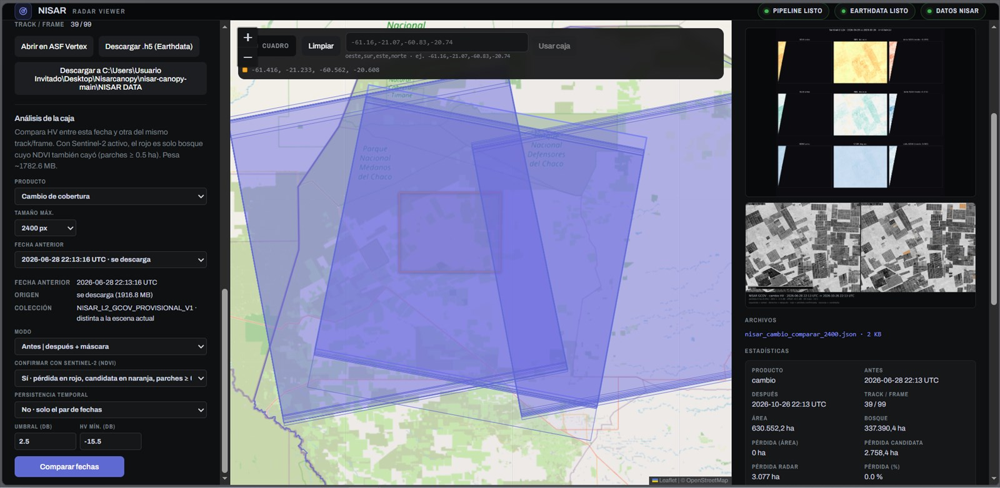
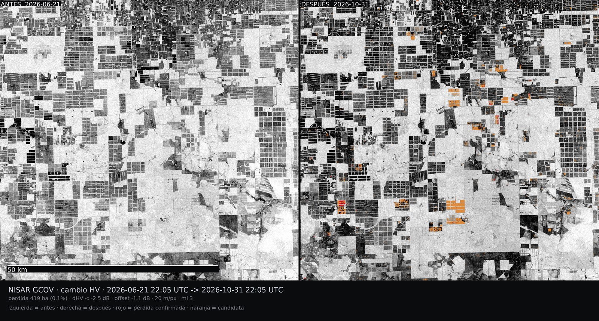
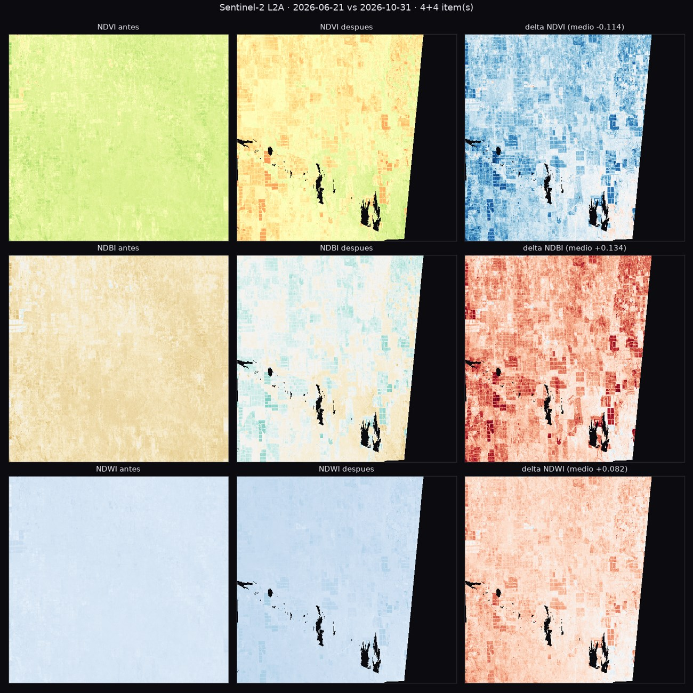
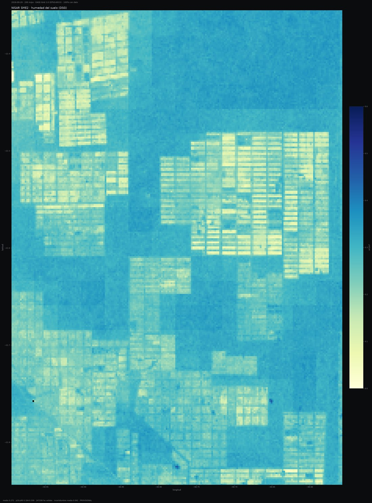
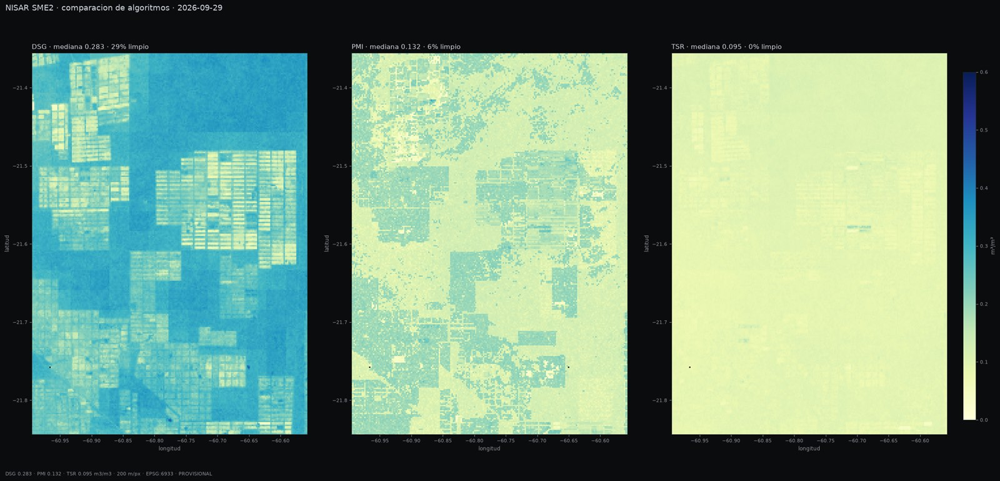

# NISAR Canopy

[](https://github.com/gillopy/nisar-canopy/actions/workflows/ci.yml)
[](https://github.com/gillopy/nisar-canopy/actions/workflows/release.yml)
[](https://github.com/gillopy/nisar-canopy/pkgs/container/nisar-canopy)
[](LICENSE)

Consola abierta para la misión **NISAR** (NASA-ISRO Synthetic Aperture Radar):
buscás escenas sobre un mapa, bajás el producto y corrés el análisis de cambio que elijas.
Backend FastAPI, frontend React + Leaflet y un pipeline de radar en Python.

Compitió en el **NASA Space Apps Challenge 2026**, reto *Dancing with the SARs*.

> **In English (short):** NISAR Canopy is an open-source console for the NASA-ISRO NISAR
> radar mission. Draw a box on a map, browse the ASF archive, and run the analysis you pick:
> GCOV change detection, 200 m soil moisture (SME2) or 12-day interferometry (GUNW). Every
> run leaves reproducible artifacts and its exact command plan. FastAPI + React; clone the
> repo and run `ARRANCAR.bat` (Windows) to get it working.

## Qué hace

Dibujás una caja sobre el mapa y la app consulta el archivo de ASF para devolver las escenas
NISAR que la cruzan, con browse y fechas. Sobre la escena elegida:

| Producto | Análisis |
| --- | --- |
| **GCOV** | recorte, RVI, cambio, serie temporal, GeoTIFF, agua, incendio, fusión óptica |
| **SME2** | humedad del suelo a 200 m (DSG, PMI, TSR) y comparación entre los tres |
| **GUNW** | coherencia y fase envuelta/desenvuelta del par de 12 días |

Cada corrida queda en un panel de trabajos con historial, log, imágenes, JSON y GeoTIFF. El
log guarda el plan exacto de comandos: un resultado se puede reproducir, no es una captura
de pantalla.

Con la verificación **Sentinel-2** activa, el análisis de cambio escribe además un panel de
**NDVI, NDBI, NDWI y NBR** (antes, después y delta) sobre la misma grilla del radar, así se
puede comparar la firma óptica con la caída de HV píxel a píxel. NBR usa **SWIR2 (B12)**, la
banda que separa dosel de suelo donde el NDVI satura; su delta (después − antes) es el
negativo del dNBR estándar, así que una pérdida aparece en negativo.

## Capturas

Todas salen del caso de estudio del Chaco, track/frame 39/99. El cambio de cobertura y los
índices ópticos son la misma corrida (2026-06-21 → 2026-10-31); la consola y la humedad del
suelo vienen de otras fechas.

### La consola



A la izquierda, qué se va a correr: producto, tamaño, fechas, modo, umbral de dB. Al centro,
el mapa con la caja dibujada y las huellas de las escenas que la cruzan. A la derecha, los
artefactos del último trabajo y sus estadísticas: área, bosque, pérdida radar y pérdida
candidata.

### Cambio de cobertura (GCOV)



HV antes y después, lado a lado. Pérdida 419 ha (0,1%) con `dHV < -2,5 dB`, `offset -1,1 dB`,
20 m/px. **Rojo** es pérdida confirmada por el NDVI de Sentinel-2; **naranja**, pérdida
candidata que el radar vio y la máscara de bosque no llegó a confirmar.

Debajo de los resultados, **Comparar antes/después** abre una ventana flotante con las dos
capas apiladas: se arrastra la línea con el mouse y el antes queda a la izquierda, el después
con la máscara a la derecha. El pipeline deja esas capas como `*_antes.png` y `*_despues.png`.

### Firma óptica (Sentinel-2)



El mismo par de fechas en tres índices y tres columnas, 4 + 4 ítems del compuesto. El delta
medio de NDVI es **-0,114**, el de NDBI **+0,134** y el de NDWI **+0,082**: verde abajo,
suelo desnudo arriba. Es la contracara óptica del panel de radar, píxel a píxel y sobre la
misma grilla.

La captura es del panel anterior: desde la incorporación de **NBR** el panel suma una cuarta
fila con NBR antes/después y su delta, con escala propia (±0,6). Todas las columnas de delta
van **después − antes**, así que el dNBR estándar (antes − después) es el negativo de esa
columna: los cortes de referencia del USGS, 0,1 / 0,27 / 0,66, se leen como valores negativos.

### Humedad del suelo (SME2)



DSG a 200 m del 2026-09-29: 100% de la caja con dato, media 0,271 m³/m³. En la escala, azul
es más húmedo y amarillo pálido más seco: las parcelas agrícolas marcan el contraste.



Los tres algoritmos sobre la misma escena, con su mediana y su cobertura válida: DSG conserva
el **29%** de los píxeles, PMI el 6% y TSR el 0%. Por eso el producto de comparación existe:
en el Chaco, DSG es el que más superficie deja ver.

## Caché de Sentinel-2

Las lecturas ópticas son remotas y caras: cada ítem son 3 aperturas (5 si se piden los
índices). El compuesto se guarda en disco y se reutiliza tal cual.

- **Ubicación**: `NISAR_S2_CACHE`; si no está, `<NISAR_MEDIA>/cache/s2`; si no, el temporal
  del sistema. En la app queda junto a los artefactos.
- **Clave**: caja, fecha, resolución, grilla de destino, bandas y **los ids de los ítems**.
  Si cambiás `--nubes`, `--dias` o `--max-items`, cambia la búsqueda y se recalcula: nunca
  devuelve un compuesto de otra búsqueda.
- **Borrar**: la carpeta se puede borrar en cualquier momento, solo cuesta bajarlo de nuevo.
  Ocupa unos 6 MB por entrada de índices a 1200 px.
- **Medido**: una corrida de cambio con índices pasó de **108 s** (caché fría) a **18 s**
  (tibia).

`--max-items` viene en 4. Medido sobre la misma caja: con 2 ítems la cobertura fue 97,4% y
con 8, 97,8%, por 65% más de tiempo. Más ítems agregan poco salvo en zonas muy nubladas.

## Requisitos

| Cosa | Para qué | Obligatorio |
| --- | --- | --- |
| **Python 3.12+** (probado en 3.13) | backend y pipeline | sí, salvo que uses uv |
| **uv** (opcional, recomendado) | crea los entornos en segundos y puede bajar el Python que falte | no |
| **Node.js 20+** | recompilar el frontend | no, el build ya está incluido |
| **Docker Desktop** | correr en contenedor | no |
| **Cuenta Earthdata** (gratis) | bajar los `.h5` de ASF | no, solo para descargar |

Windows es el entorno soportado por los scripts `.bat`/`.ps1`. En Linux/macOS el backend
corre igual, pero el arranque es a mano (ver *Modo manual*).

> 3.11 **no** alcanza: `numpy 2.5` exige Python 3.12 o superior.

## Arranque rápido

1. Cloná el repo.
2. Doble clic en **`ARRANCAR.bat`**.

El script detecta `uv` o Python, prepara los dos entornos, te pregunta dónde guardar los
datos, levanta el servidor y abre el navegador.

La primera vez tarda unos minutos si instala todo desde cero. **Con `uv` instalado son
segundos**: resuelve desde `uv.lock` en vez de calcular versiones.

Para apagarla: **`APAGAR.bat`**.

### Qué te va a preguntar

- **Carpeta de datos**: dónde se guardan los `.h5`. Cada escena ronda los 2 GB. Elegí un
  disco local, fuera de OneDrive.
- **Credenciales Earthdata**: usuario y contraseña de <https://urs.earthdata.nasa.gov/>.
  Son gratis y solo hacen falta para descargar productos. Podés saltearlas: la búsqueda y
  el browse funcionan sin cuenta.
- **FIRMS MAP_KEY**: opcional, solo para el producto de incendio.

Todo queda en dos archivos `.env` locales, que **no** se versionan.

## Entornos: uv primero, pip como respaldo

El repo tiene **dos proyectos independientes**, a propósito: el backend no tiene por qué
cargar `rasterio` ni `matplotlib`.

| Proyecto | Entorno | Dependencias |
| --- | --- | --- |
| raíz | `.venv` | pipeline de radar |
| `nisar-app/` | `nisar-app/.venv` | API, uvicorn, cola de jobs |

Cada uno declara sus dependencias en su `pyproject.toml` y las resuelve en su `uv.lock`.
`.python-version` fija 3.13, que es la versión con la que está probado.

```powershell
uv sync                    # pipeline
uv sync --directory nisar-app   # backend
```

**Si no tenés uv**, `setup.ps1` cae automáticamente a `venv` + `pip` con los
`requirements-*.txt`. Esos archivos **no se editan a mano**: son un export fijado del lock.

```powershell
uv export --format requirements-txt --no-hashes --no-emit-project --output-file requirements-pipeline.txt
```

Para agregar una dependencia: editá el `pyproject.toml` correspondiente, `uv lock`, y volvé
a exportar los requirements para que el camino sin uv siga funcionando.

## Docker

Hay dos caminos: usar la **imagen publicada** (no compilás nada) o construir la tuya.

### Imagen publicada

Cada release publica `ghcr.io/gillopy/nisar-canopy` con la etiqueta de la versión, la
`major.minor` y `latest`.

```bash
docker run --rm -p 127.0.0.1:8010:8010 \
  -v /ruta/a/los/h5:/data/nisar \
  -v /ruta/a/artefactos:/app/nisar-app/var/media \
  ghcr.io/gillopy/nisar-canopy:latest
```

Reemplazá las dos rutas por carpetas reales de tu equipo. **Abrí `http://127.0.0.1:8010`** en
el navegador: la app no lo abre sola y la terminal queda ocupada (con `-d` corre en segundo
plano).

Para bajar los `.h5` hace falta Earthdata: creá un archivo `.env` con `EARTHDATA_USER` y
`EARTHDATA_PASSWORD`, y agregá `--env-file .env` al comando. Sin credenciales la app arranca
igual y la búsqueda y el browse funcionan. Usá `--env-file` en vez de `-e
EARTHDATA_PASSWORD=...`: un `-e` con la clave queda en el historial del shell y en la lista de
procesos, y el archivo se puede proteger con permisos.

### Con los scripts

```powershell
ARRANCAR.bat docker
```

O a mano:

```powershell
docker compose build
docker compose up -d
```

La app escucha en `http://127.0.0.1:8010` (o el `PORT` de tu `.env`). Los `.h5` se montan
desde `NISAR_DATA` y los artefactos desde `NISAR_MEDIA`.

La caché de Sentinel-2 vive dentro del volumen de artefactos
(`/app/nisar-app/var/media/cache/s2`): sobrevive a los reinicios del contenedor y se borra
junto con los artefactos. El límite administrativo de GADM no entra en la imagen
(`.dockerignore`), así que el preset de Paraguay responde 404 igual que en un clon limpio.

El build instala con **uv** (`uv pip install --system`) a partir de los requirements
exportados de `uv.lock`: mismas versiones que en local, fijadas, y una instalación bastante
más rápida que con `pip`.

> La app ejecuta subprocesos y no tiene autenticación: escucha solo en loopback a propósito.
> Para exponerla a Internet hace falta un proxy con HTTPS y, si es pública, un modo demo con
> artefactos precalculados y límites de descarga.

## Versiones, releases e imagen

El repo usa **tags de git** como única fuente de verdad de las versiones. Un tag `vX.Y.Z` dispara
`.github/workflows/release.yml`, que hace todo junto:

1. Construye la imagen y la publica en **GitHub Container Registry** (`ghcr.io/gillopy/nisar-canopy`),
   con etiquetas `X.Y.Z`, `X.Y` y `latest`.
2. Publica la imagen con **SBOM y procedencia** adjuntas: se puede auditar con qué se construyó.
3. Crea el **Release** en GitHub con las notas generadas del rango de commits.

```bash
git tag -a v0.2.0 -m "v0.2.0"
git push origin v0.2.0
```

No hace falta tocar nada más. `main` corre los tests en cada push y en cada pull request
(`.github/workflows/ci.yml`): si el lock queda desactualizado, `uv sync --frozen` falla y el
build del release también.

| Quiero | Comando |
| --- | --- |
| Ver las versiones | <https://github.com/gillopy/nisar-canopy/releases> |
| Bajar la última imagen | `docker pull ghcr.io/gillopy/nisar-canopy:latest` |
| Bajar una versión exacta | `docker pull ghcr.io/gillopy/nisar-canopy:0.1.0` |

## Modo manual (sin los `.bat`)

```powershell
.\setup.ps1
.\configurar.ps1 -Modo Local
.\run.ps1
```

En Linux/macOS, el equivalente:

```bash
uv sync && uv sync --directory nisar-app
nisar-app/.venv/bin/python -m uvicorn nisar_backend.main:app --app-dir nisar-app --port 8010
```

Sin uv, reemplazá la primera línea por:

```bash
python -m venv .venv && .venv/bin/pip install -r requirements-pipeline.txt
python -m venv nisar-app/.venv && nisar-app/.venv/bin/pip install -r nisar-app/requirements.txt
```

## Configuración

`configurar.ps1` escribe dos archivos, y los dos están en `.gitignore`:

| Archivo | Variables |
| --- | --- |
| `.env` | `NISAR_DATA`, `NISAR_MEDIA`, `PORT` |
| `nisar-app/.env` | `EARTHDATA_USER`, `EARTHDATA_PASSWORD`, `FIRMS_MAP_KEY` |

`env.example` documenta cada variable. La plantilla se puede editar a mano; el asistente la
respeta si ya existe una carpeta elegida, para no perder el historial de trabajos.

## Desarrollo del frontend

```powershell
cd nisar-app\frontend
npm install
npm run dev          # Vite en :5174, con proxy al backend en :8010
npm run build        # recompila dist/, que SI se versiona
```

`nisar-app/frontend/dist` se versiona a propósito: así el repo funciona sin Node. Si tocás
el frontend, acordate de correr `npm run build` y commitear el `dist/`.

## Tests

```powershell
nisar-app\.venv\Scripts\python.exe -m unittest discover -s nisar-app\nisar_backend\tests -q
```

45 tests, sin red: cubren el contrato de la API, la validación de la caja, el proxy de
browse, la detección de `.h5` en disco, la timeline y el plan exacto de cada producto. Las
búsquedas reales contra ASF se comprueban a mano.

## Estructura

```text
.
├── ARRANCAR.bat          arranque en un paso (local por defecto)
├── ARRANCAR-LOCAL.bat    alias de ARRANCAR.bat sin argumentos
├── APAGAR.bat            baja el contenedor o el servidor local
├── configurar.ps1        asistente: carpetas, credenciales y puerto
├── setup.ps1             prepara los dos entornos (uv, o pip de respaldo)
├── run.ps1               levanta uvicorn con la config del .env
├── pyproject.toml        dependencias del pipeline (fuente de verdad)
├── uv.lock               resolucion fijada del pipeline
├── .python-version       3.13
├── requirements-pipeline.txt   export fijado, para pip/Docker
├── Dockerfile            imagen de la app
├── docker-compose.yml    servicio con volumenes y healthcheck
├── comun/                kit NISAR, rutas, Sentinel-2, optico, FIRMS
├── descargar/            descarga de escenas desde ASF
├── prototipos/           renderizadores NISAR (GCOV, SME2, GUNW)
├── datos/                recursos auxiliares del pipeline
├── docs/                 capturas de este README
└── nisar-app/
    ├── pyproject.toml    dependencias del backend
    ├── uv.lock           resolucion fijada del backend
    ├── nisar_backend/    FastAPI: API + cola de jobs
    ├── frontend/         React + Leaflet (src y dist)
    ├── tests/
    └── requirements.txt  export fijado, para pip/Docker
```

Aunque `uv sync` cree un `.venv` sin `pip`, los requirements siguen existiendo para el
camino de respaldo y para la imagen Docker.

## Datos y créditos

- **NISAR L2 GCOV, L3 SME2, L1 GUNW** (colecciones PROVISIONAL): NASA / ISRO, archivados por
  [ASF DAAC](https://search.asf.alaska.edu/). Acceso con Earthdata Login.
- **Sentinel-2 L2A**: ESA Copernicus, vía [Microsoft Planetary Computer](https://planetarycomputer.microsoft.com/).
- **FIRMS**: NASA EOSDIS, para los focos de calor del producto incendio.
- **OpenStreetMap**: mapa base del visor (© OpenStreetMap contributors, ODbL).

Las licencias completas de lo que el repositorio **redistribuye** (fuentes, Leaflet, React),
el detalle de lo que solo se **instala** y de lo que se **descarga** en tiempo de ejecución
están en [THIRD-PARTY.md](THIRD-PARTY.md).

NISAR es una misión conjunta de NASA y la Indian Space Research Organisation. Este proyecto
es de participantes del NASA Space Apps Challenge: no es un producto de NASA.

### Límite de Paraguay

`datos/paraguay_gadm.json` **no se versiona**: proviene de GADM 4.1, cuya licencia permite
uso académico y no comercial pero no su redistribución. El preset de Paraguay responde 404
si el archivo no está.

Para habilitarlo, bajá un límite administrativo de Paraguay con licencia compatible y
guardalo con ese nombre:

- [Natural Earth](https://www.naturalearthdata.com/) — dominio público, sin restricciones.
- [geoBoundaries](https://www.geoboundaries.org/) — CC-BY 4.0.

El resto de la app funciona sin ese archivo.

## Uso de asistencia con IA

El NASA Space Apps Challenge permite usar herramientas de inteligencia artificial y pide
declararlo. En este proyecto se usaron modelos de lenguaje para:

- escribir y revisar parte del código del backend, del frontend y de los scripts del pipeline;
- redactar y ordenar la documentación;
- contrastar decisiones de diseño y reproducir errores.

**No** se usaron para generar imágenes ni audio, y **no** se usó ningún elemento de marca de
NASA: la app no incluye logos, insignias ni identificadores gráficos de la misión.

Las decisiones de alcance, la elección de las áreas de estudio, la interpretación de los
resultados y la validación contra datos reales son del autor. Cada cifra del caso de estudio
sale de un recorte de la escena y de un par de fechas que están declarados en el código.

Si reusás este proyecto, revisá el código antes de confiar en él: es una herramienta de
exploración, no un producto operativo.

## Cómo citar

El repo trae `CITATION.cff`, así que GitHub muestra un botón "Cite this repository".

> Cabrera, G. (2026). *NISAR Canopy* (v0.1.0) [Software].
> <https://github.com/gillopy/nisar-canopy>

Si el trabajo usa el caso de estudio del Chaco, citá también los datos de origen: NISAR L2
GCOV, NASA/ISRO, archivados por ASF DAAC.

## Problemas comunes

- **El puerto 8010 está ocupado**: `configurar.ps1` muestra el PID y pide otro. Si lo ocupa
  el propio contenedor, lo recrea solo.
- **`FileNotFoundError` en la carpeta de datos**: la unidad o la ruta no existe (por ejemplo,
  un disco externo desconectado). Volvé a correr `configurar.ps1` y elegí una carpeta local.
- **`python` abre la Microsoft Store**: es el alias falso de Windows, no un intérprete. Con
  `uv` instalado el problema desaparece; si no, instalá Python desde python.org.
- **Docker no responde**: `ARRANCAR.bat docker` espera hasta 3 minutos. Si no arranca, abrí
  Docker Desktop hasta que diga "Engine running" y reintentá.
- **Datos y artefactos en la misma carpeta**: funciona, pero conviene separarlos
  (`.../nisar-data` y `.../nisar-media`, que es el default).

## Licencia

MIT. Ver [LICENSE](LICENSE).
